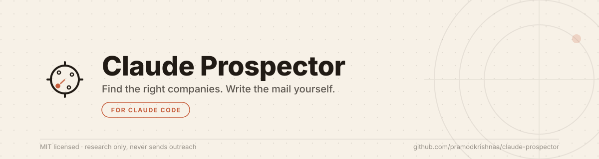
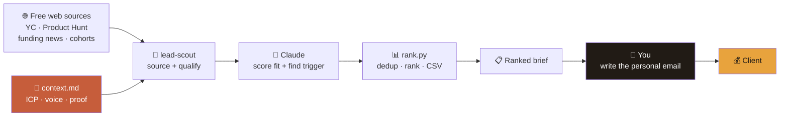

<picture>
  <source media="(prefers-color-scheme: dark)" srcset="assets/banner-dark.svg">
  <source media="(prefers-color-scheme: light)" srcset="assets/banner-light.svg">
  
</picture>

<div align="center">

[](LICENSE)


</div>

---

## Why this exists

Everyone is racing to make AI write the outreach. That's backwards.

When every inbox is full of the same auto-generated "Hi {first_name}, I noticed
you're the {title} at {company}…" slop, the *only* thing that still books a call
is a message a human actually wrote — because they actually looked.

So Claude Prospector flips it:

> **Let the machine do the boring, tedious, time-eating part** — finding the
> right companies, spotting the trigger, digging up the proof and the contact —
> **and let the human do the part that wins: the personal message.**

The AI does the dirty work. You get clients.

---

## What it does

Three skills, one config file you own (`context.md` — your ICP, voice, proof
and case studies live in one file every skill reads).

| Skill | What it does |
|-------|--------------|
| 🔎 **`lead-scout`** | Scours free public sources → a **ranked prospect brief**: company, real trigger, matching case study, *public* contact, and 2–3 angles you turn into your own email. |
| 📄 **`proposal`** | Turns a scope conversation into a tight one-page proposal + price framing that drives to a call. |
| ✍️ **`copy`** | Landing pages, case-study writeups and founder content — in your brand voice, proof-led, zero buzzwords. |

---

## How it works



**AI owns everything up to the brief. You own the message.** That dark box is
the whole point.

---

## Sample brief

Real shape of what `rank.py` outputs (leads ranked by *fit × how fresh the
trigger is*):

```markdown
# Prospects
_2 qualified, ranked by fit x trigger recency._

## 1. Loamly  |  score 0.7671
- What: usage-based billing infra for B2B SaaS
- Who: Tom Vashee  |  Contact: tom@loamly.io
- Trigger: launched on Product Hunt (#2 of the day)  (2026-09-28)
- Fit: closest proof = your most relevant case study
- Angle (your talking points - you write the mail):
    - founder is camera-ready but has zero content cadence
    - PH momentum is decaying - needs follow-up now
    - [your case study] solved exactly this for a similar founder
- source: https://www.producthunt.com/products/loamly

## 2. Fernwehr  |  score 0.7369
- What: CI observability for platform teams
- Who: Ana Reddy  |  Contact: @anareddy
- Trigger: raised $3.2M seed (Accel)  (2026-09-24)
- Fit: closest proof = your most relevant case study
- Angle (your talking points - you write the mail):
    - landing page buries the product under jargon
    - seed close = short launch window
    - you shipped something comparable for [case study] in one pass
- source: https://techcrunch.com/2026/09/24/fernwehr-seed
```

You read three bullets, you know exactly why this company should care, you
write four sentences that only you could have written. That's the loop.

---

## Quick start

**Requires:** [Claude Code](https://claude.com/claude-code) and Python 3.9+.

```
/plugin marketplace add pramodkrishnaa/claude-prospector
/plugin install prospector@claude-prospector
```
(send these as two separate messages — the install only registers after the
marketplace add completes)

Then just ask:

```
Find me recently funded B2B SaaS leads.
Draft a proposal for Loamly — they need a launch film + landing page.
Write landing-page copy for a devtools launch.
```

**First run bootstraps itself:** the first time you run any `prospector:*`
skill, it notices you don't have a config yet, copies the template to
`~/.claude/prospector/context.md`, and asks you to fill it in — your company,
ICP, proof, voice, and pricing stance. Everything else reads from that one
file. Running an agency with multiple clients? Drop a `prospector.context.md`
in a project folder to override the global one for just that project.

---

## Design principles

- **Research is automated; outreach is not.** No skill drafts or sends a
  single email. Ever.
- **No guessed contacts.** Only genuinely public emails/handles make the
  brief — guessing patterns is how you become spam.
- **Every claim is sourced.** Each lead carries a `source_url` you can verify
  in one click. No hallucinated triggers, no invented metrics.
- **Quality over volume.** Five sharp, well-triggered leads beat fifty
  guesses.
- **Config, not code.** Changing who you target or how you sound means
  editing one Markdown file — never a skill.

---

## Repo structure

```
claude-prospector/
├── .claude-plugin/
│   ├── plugin.json
│   └── marketplace.json
├── assets/                      # logo + banner (light/dark)
├── skills/
│   ├── lead-scout/
│   │   ├── SKILL.md            # source → qualify → brief pipeline
│   │   └── scripts/rank.py     # deterministic dedup · rank · CSV (self-tested)
│   ├── proposal/SKILL.md
│   └── copy/SKILL.md
├── templates/
│   └── context.template.md     # bootstrapped into ~/.claude/prospector/context.md on first run
└── README.md
```

`rank.py` ships a self-test: `python skills/lead-scout/scripts/rank.py --selftest`.

---

## Roadmap

- [ ] RAG over past outreach so the agent learns which angles book calls
- [ ] Reply-tracking integration with a tracker of your choice
- [ ] Pluggable source connectors (paid lead APIs) once free sourcing proves the channel

---

<div align="center">

*The tedious part is the machine's job. The human part is yours.*

</div>
